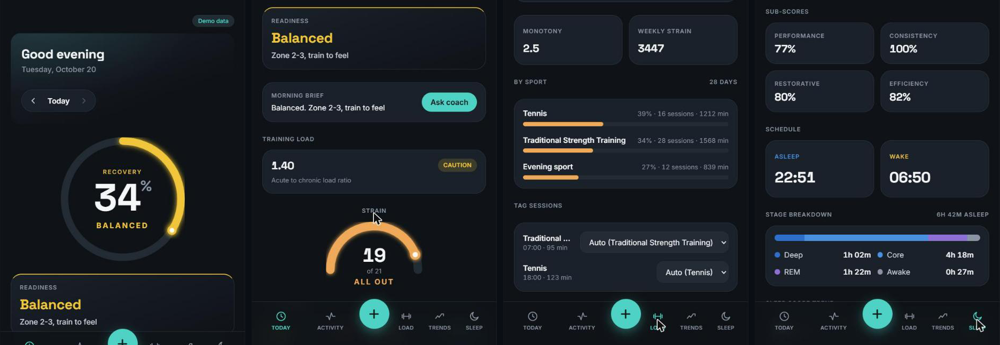

# Personal Health Coach

A single-user, Whoop-style dashboard built on Apple Watch / Apple Health data. It turns raw HRV, resting heart rate, sleep, workouts, and activity into daily **recovery**, **sleep**, **strain**, and **training-load** scores, scored against your own rolling baseline rather than population averages.

Built with React 19, TypeScript, Vite, and Tailwind CSS. The scoring logic is written as pure, unit-tested functions, separate from the UI.



*Screens shown with the built-in synthetic demo data (`?demo=1`): recovery ring and readiness, strain gauge, acute-vs-chronic training load by sport, and sleep stages.*

## What it shows

- **Today:** recovery ring, a readiness banner (the lead signal), training load, strain gauge, and an at-a-glance grid (recovery, strain, sleep, HRV, steps, active calories, resting HR, respiratory rate) with day-over-day deltas.
- **Sport Load:** acute vs chronic load (ACWR gauge with a plain-language caution band), monotony, weekly strain, and a per-sport breakdown over 28 days. Workouts can be tagged with a sport.
- **Coach:** a morning brief and short chat opened from the Today card. Answers are rule-based and built from your recovery, sleep, HRV and load numbers (see below).
- **Sleep:** sleep score versus a computed sleep need, sleep stages, and sleep debt.
- **Activity:** move / exercise / stand rings, an activity heatmap, and distance and flights charts.
- **Trends:** charts across days, with a detail sheet for every metric that explains the drivers behind the number.
- **Demo mode:** open the app with `?demo=1` to use realistic synthetic data instead of the live database (a "Demo data" pill is shown).
- **Calibration banner:** shown while there isn't enough history to build a reliable baseline.

## The scoring engines (`src/metrics/`)

| Engine | What it computes |
|---|---|
| `recovery` | Recovery (0 to 100%) from overnight HRV and resting heart rate, as standardized deviations from a rolling baseline |
| `sleep` | Sleep score (0 to 100) versus a personalized sleep need |
| `strain` | Cardiovascular strain (0 to 21) from workout heart-rate data, relative to max heart rate |
| `load` | Acute versus chronic training load and monotony, used to flag overtraining risk |
| `baseline` | Rolling mean and standard deviation used by the other engines |

Weights and constants are tunable defaults intended to be calibrated against real data. Coaching guidance (readiness downgrades, intensity targets, HRV trend) is derived deterministically from these outputs.

## Coach

The coach (`src/coach/`) is an offline rules engine by default: no network calls, no LLM. It sits behind a small `CoachAdapter` interface. To plug in your own model, set `VITE_COACH_ENDPOINT` (see `.env.example`) to the URL of a server you run; the app will POST the coach context and your free-text question there and show the reply. On any failure (network error, timeout, non-2xx, malformed reply) it falls back to the offline rules coach and logs a `console.warn`. The endpoint must answer the CORS preflight (allow `Content-Type: application/json`), and must be served over https on the deployed Pages site (an http endpoint is blocked as mixed content).

**Never put an API key in the client.** Any `VITE_` variable is bundled into the public JS. The endpoint must be your own server, which holds any provider key itself.

### LLM coach server (optional)

`server/coach-server.mjs` is a dependency-free Node server (Node 20.6+) that implements that endpoint with an NVIDIA NIM chat model (default `deepseek-ai/deepseek-v4.1-flash`).

```bash
cp server/.env.example server/.env      # add NVIDIA_API_KEY (git-ignored)
npm run coach:server                    # http://localhost:8787
echo "VITE_COACH_ENDPOINT=http://localhost:8787/coach" > .env.local
npm run dev
```

- The browser sends only the already-computed numbers and labels (recovery, HRV, sleep debt, load ratio and so on), never raw workouts or timestamps.
- The server holds the key, checks the request origin against an allowlist, caps body and question size, rate-limits per IP, and logs failure reasons only (never bodies or keys).
- The system prompt tells the model to use only the supplied numbers, stay brief, avoid hard training when load or readiness is flagged, and defer to a professional for symptoms.
- If the model is slow or unavailable, the app falls back to the offline rules coach after the client timeout.
- The deployed GitHub Pages site cannot reach a `localhost` server. To use the LLM coach there, host `coach-server.mjs` somewhere with https and set `ALLOWED_ORIGINS` to your Pages origin.

## Data

The app reads Health Auto Export JSON (the iOS app that exports Apple Health data) through `src/lib/parseHaeJson.ts` and loads it from a Firebase Realtime Database configured in `src/lib/firebase.ts`. There are also importers for CSV and ZIP exports (`csv.ts`, `loadZip.ts`, `healthExport.ts`).

**This repository includes health data belonging to the owner:** its git history contains a sample export under `.superpowers/` (untracked in `bc3e65d`, still present in earlier commits), and the app reads a public Firebase database. Treat health data as sensitive: restrict read access on whatever database you point the app at, and don't commit exports.

## Getting started

```bash
npm install
npm run dev        # local dev server
npm test           # unit tests (Vitest)
npm run build      # type-check and production build
npm run lint
```

Point `src/lib/firebase.ts` at your own database before running, or append `?demo=1` to the URL to explore with synthetic data and no database.

## Tests

Vitest unit tests cover the CSV and JSON parsers, the export pipeline, and each scoring engine (recovery, sleep, strain, load, baseline).

## Deployment

A GitHub Actions workflow (`.github/workflows/deploy.yml`) builds the app and publishes it to GitHub Pages on pushes to `main`, `master` or `feat/plan-1-foundation` (the repo's default branch), and on manual dispatch. In the repo settings, set Pages source to "GitHub Actions".

Will be live at https://ShreyasK06.github.io/personal-health-coach/ once Pages is enabled and the workflow has run (add `?demo=1` for synthetic data).

## Project layout

```
src/
  metrics/       Scoring engines and their tests
  lib/           Parsers, importers, data loading, UI helpers
  components/    Rings, gauges, charts, cards, navigation
  screens/       Today, Sleep, Activity, Trends, and detail sheets
docs/
  superpowers/   Design spec and implementation plan
```

## Status

Active personal project.

**Real and working:** the scoring engines (recovery, sleep, strain, load, baseline) with unit tests; the five-tab UI (Today, Activity, Load, Trends, Sleep); the rules-based coach; the demo data mode.

**Not there yet:**
- No LLM by default. The coach is rules-based; an LLM only enters via your own server behind `VITE_COACH_ENDPOINT`.
- Data is read from a Firebase Realtime Database; the Supabase ingest endpoint from the original design was not built.
- Calibration still uses default weights and constants; they have not been tuned against enough real data.
- Not medical advice or diagnosis.

See the "Deviations from this spec" section at the end of the design doc.
